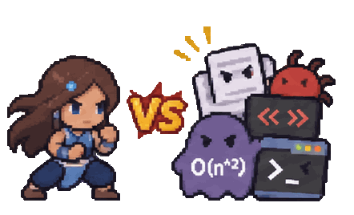

<h1 align="left">Hi! I'm Kaylinn 👋</h1>

###

  
  
  

###

🎓 Computer Science and Engineering @ CUHKSZ

🌊 Interested in Deep Learning, Computer Vision, NLP, and Avatar: The Last Airbender

  

###

  

###

<h3 align="left">🛠 Language and tools</h3>

###

  
  
  
  
  
  
  
  
  
  
  
  
  
  
  
  
  
  
  
  
  
  
  
  
  
  
<!-- AI / Machine Learning -->

<!-- Backend / Databases -->

<!-- Frontend / Development -->

###
